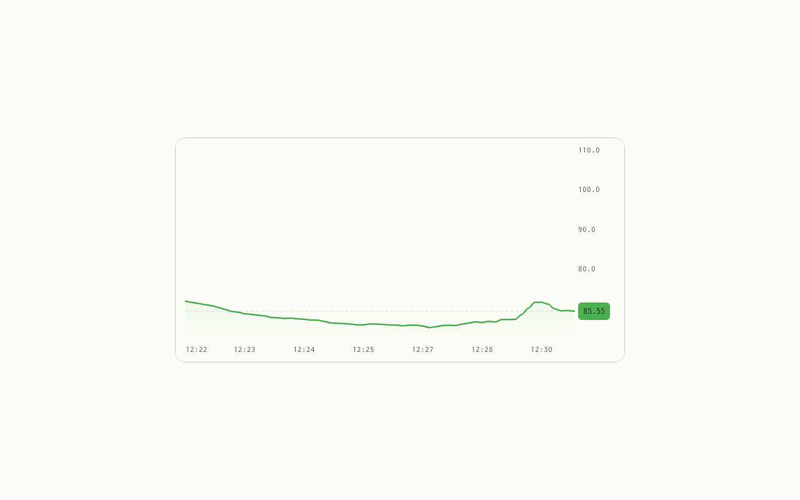

# Liveline

Liveline is a real-time line chart control for Uno Platform, drawn with SkiaSharp. This sample shows one chart on a
live feed: a short loading state, then a volatile random walk with a new value every 150 ms.



## What it shows

- **The chart:** a smooth line with a gradient fill, a grid with value and time labels, a badge with the latest value,
  and a live dot at the line's end.
- **Easing:** the line, the value range and the badge ease toward each new value (`LerpSpeed`).
- **Idle when settled:** the control draws on `CompositionTarget.Rendering` only while the line moves, and lets go of
  it once the line settles.
- **The app's theme:** the chart's default style binds every colour to a palette role (`PrimaryBrush` for the line and
  badge, `SurfaceBrush`, `OutlineVariantBrush`, `OnSurfaceVariantBrush`, `OnPrimaryBrush`), so it follows Light, Dark and
  any palette (a seed, an override, Studio's Themes tab) with no wiring. Any brush can be set on the chart to override it.

The data is simulated on the page; nothing leaves the device.

## Built with

- Uno Platform single project, with Uno.Sdk pinned in `global.json`: desktop and WebAssembly.
- SkiaSharp on `SKCanvasElement` (the `Skia` feature).
- Material through `MaterialToolkitTheme`, with the brand as one seed (`PrimarySeed` in `App.xaml`): every colour, corner
  and margin on screen comes from Uno.Themes (palette roles, `Radius*` and `Space*` tokens).
- `utu:Responsive` sets the card's height for phone and desktop.
- The control is the `Liveline/` folder of the project, with its default style in `Themes/Generic.xaml`; the page in
  `MainPage.xaml` hosts it.

## Try it

You need the .NET 10 SDK; the Uno.Sdk version comes from `global.json`.

```bash
# Desktop
dotnet run --project Liveline.Demo/Liveline.Demo.csproj -f net10.0-desktop

# WebAssembly
dotnet publish Liveline.Demo/Liveline.Demo.csproj -f net10.0-browserwasm -c Release -o publish
# then serve publish/wwwroot with any static file server
```

In Visual Studio, Rider or VS Code, open `Liveline.sln`.

## Use the control

```xml
<liveline:LivelineChart x:Name="Chart" ShowGrid="True" ShowBadge="True" ShowFill="True"
                        Momentum="True" LerpSpeed="0.04" />
```

```csharp
Chart.Data = points;   // IList<LivelinePoint>: time and value
Chart.Value = latest;  // the value the badge and the live dot show
```

The colours need no code: they come from the app's Material or Simple theme. To give one chart other colours, set its
brushes to other roles, in pairs:

```xml
<liveline:LivelineChart LineBrush="{ThemeResource TertiaryBrush}" BadgeTextBrush="{ThemeResource OnTertiaryBrush}" />
```

In an app project, merge the control's default style in `App.xaml`
(`<ResourceDictionary Source="ms-appx:///Themes/Generic.xaml" />`); a control library loads it by itself.

## Layout

| Path | What is there |
|---|---|
| `Liveline.Demo/MainPage.xaml(.cs)` | the page and its simulated feed |
| `Liveline.Demo/Liveline/` | the control: `LivelineChart`, its `SKCanvasElement` canvas, the renderers, the easing engine, the models |
| `Liveline.Demo/Themes/Generic.xaml` | the chart's default style: its template and its theme brushes |
| `.studiolive/`, `uno-sample.json` | the Studio info files, icon and screenshots |
